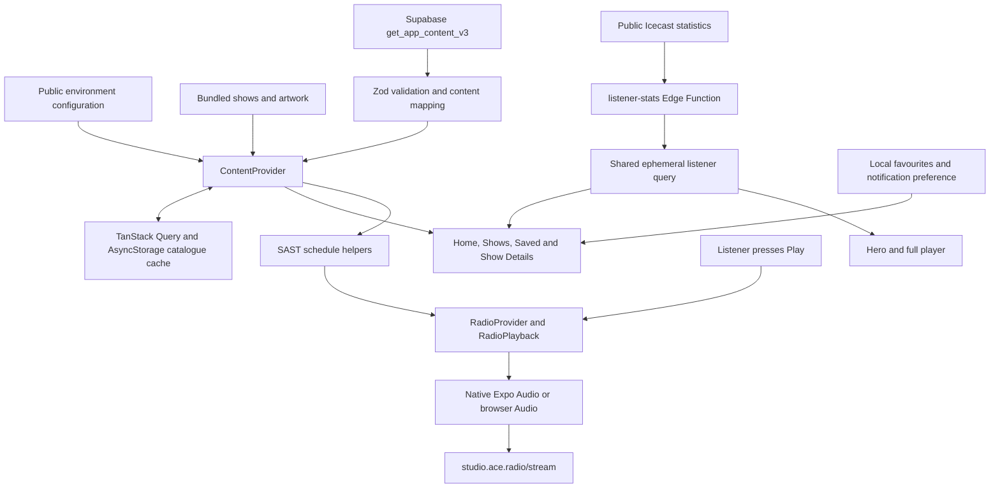
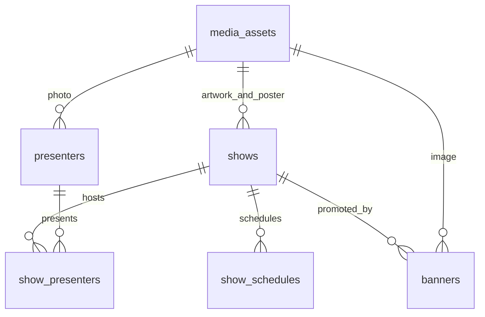

# AceRadio codebase overview

**Subsequent implementation on 16 October 2026:** accounts, two-role permissions, MFA-backed admin writes and cached favourites/settings sync are now deployed. The detailed account architecture and email setup requirement are in [accounts.md](accounts.md); that document supersedes the local-only favourites and old staff-role descriptions in this initial audit snapshot below.

Reviewed on 16 October 2026 against the application source, backend scripts, migrations, tests and linked Supabase project `dbgpfqyighcaquxwzkfe`. Counts and environment observations below are a dated snapshot.

## Application structure

This is a TypeScript Expo Router application for Android, iOS and web. `package.json` specifies Expo SDK 57, React 19.2.3, React Native 0.86.3, Expo Audio 57.0.5, Supabase JS, TanStack Query and Zod. Metro transforms the existing SVG logo; shared colours, spacing and typography live under `src/theme/`.

`app/_layout.tsx` loads icon fonts behind the splash, supplies safe areas and the dark navigation theme, and mounts providers in this order: `ContentProvider` -> `FavoritesProvider` -> `RadioProvider`. The audio provider remains available through content loading/errors. Expo Router renders the tabs plus the player and show-detail overlays.

| Route | Behaviour and main dependencies |
| --- | --- |
| `/` | Live radio hero, current/next SAST schedule, announcements, promotional banners, spotlight, show carousel and About link |
| `/shows` | Search by show/presenter/day; All, Live now, Weekdays and Weekend filters combine with search |
| `/favorites` | Shows whose stable IDs are saved locally; unavailable favourites retain their stored IDs |
| Chat tab action | Opens `ChatOptionsModal` over the current page; WhatsApp launches the official studio link; in-app chat displays a Coming soon notice |
| `/chat` | Direct links redirect to Home |
| `/settings` | Notification preference, sleep timer, official contact/social links and app information |
| `/about` | Bundled story, founders/photos, timeline, location and vision; hidden from the tab bar |
| `/show/[id]` | Finds the selected content ID, shows schedule/artwork/bios/poster, saves favourites; Listen Live is enabled only while that show is scheduled |
| `/player` | Full controls for the same shared station player; errors/retry and current listener count |

`ShowCard` is reused by Home, Shows and Saved. `ShowGrid`/`ShowCarousel` adjust columns for width and large text. The mini-player keeps play/pause and stop beside its metadata in one compact row, and the pages reserve clearance above it. `ShowSpotlight` mounts three neighbouring slides, advances every 5.5 seconds, and pauses for interaction, lost focus, backgrounding, reduced motion or detected screen-reader use.

`useModalTransition` owns sheet entry/exit and waits for exit before route removal. It guards Android Back, close taps and browser history. `PageScrollView` resets on tab entry/reselection while preserving the page under a modal. `useShowTransition` crossfades selected artwork/text; accessibility reduced motion disables these animations.

## Data flow and local storage

`src/config/content.ts` chooses Supabase only for the exact `EXPO_PUBLIC_CONTENT_SOURCE=supabase` value. Otherwise it chooses bundled content. Remote mode requires an HTTPS project URL and a publishable or legacy anon key; it rejects privileged keys. `src/services/supabase.ts` lazily creates a typed public client with session persistence, refresh and URL-session detection disabled. There is no listener login flow.

On this checkout, `.env.local` currently selects **bundled** content and contains the intended project's URL/public key. Linking the CLI does not change the app's source. In bundled mode `src/data/shows.ts` supplies 11 shows and local artwork; spotlight banners are derived from the posters, with no presenter catalogue or announcements. The station identity, stream URL, contacts and social links always come from `src/config/station.ts`; About comes from `src/data/about.ts`.

In remote mode `src/services/contentRepository.ts` fetches one `get_app_content_v3()` response, validates it with Zod, joins presenter names in position order, formats structured schedules, and constructs public Storage image URLs. Missing bios/images remain absent. Version 1/2 cached responses remain accepted, with obsolete station fields discarded.

`ContentProvider` deduplicates requests, uses a 60-second stale time and foreground polling, and persists successful catalogue payloads for seven days. The cache is scoped to project/source/version. Requests time out after 15 seconds with two query retries. Valid cached content survives failed refreshes; first-load failures offer Retry. Local window filtering removes expired banners/announcements every 30 seconds and on foreground return.

| Local state | Storage/lifetime |
| --- | --- |
| Favourite IDs | AsyncStorage `aceradio:favorites:v1`; stable show IDs preserve saved selections across imports |
| Future notification preference | AsyncStorage `aceradio:push-enabled`; no push token, permissions request or delivery service |
| Public catalogue | AsyncStorage `aceradio:content:v1:<project URL>` through TanStack persistence |
| Listener statistics | Query memory only; excluded from persisted catalogue |
| Selected show, playback state, sleep timer | Provider/controller memory; not account-backed |

## Radio playback and scheduling

All shows play the same `https://studio.ace.radio/stream` URL. There are no recordings, per-show stream URLs, song skipping or seeking. First Listen Live chooses a currently scheduled show, or the generic station broadcast between shows. Previous/next cycle through the currently live lineup, and are enabled only when multiple shows overlap. Resuming retains the selected show metadata; schedule updates do not automatically replace it with the next show's identity.

`src/utils/showSchedule.ts` evaluates South African time independently of the device timezone. Structured slots support weekly days, effective dates and overnight end times; starts are inclusive and ends exclusive. Bundled schedules are parsed from their printed day/time strings. `RadioProvider` recalculates the live lineup every 30 seconds.

`RadioPlayback` is a shared state machine: idle, loading, playing, paused and error. No audio resource is created before Play. Generation/request guards reject callbacks from replaced or cancelled sessions; a 25-second loading deadline releases a stalled stream. Changing show metadata while playing reuses the active transport.

Native `radioTransport.ts` uses Expo Audio, configures audio focus/background mode, maps native status events into the controller, and supplies system media metadata. Pause retains the native session for remote resume; resume reconnects to current live audio. Explicit stop releases listeners, the player and system controls. Packaged artwork is copied to a readable file independently of starting audio.

Browser `radioTransport.web.ts` uses `Audio`, media events and optional Media Session APIs. The browser transport is released on controller pause and recreated on resume. System browser pause calls the audio element directly. Player/detail dismissal leaves playback active. The mini-player appears after successful playback and its close action stops audio and clears the selection after its fade.

The sleep timer offers Off/15/30/45/60 minutes. It uses a JavaScript timeout and calls `stop()` when it fires; background timing still needs physical-device verification. Notification settings are unrelated to playback's system media notification.

`patches/expo-audio+57.0.5.patch` extends Android/iOS media commands, live resume, artwork support, binder separation and cleanup. `patches/react-native-web+0.21.4.patch` guards untracked mouse releases. `postinstall` applies both with `patch-package --error-on-fail`. Dependency upgrades need patch review. Expo Go supports foreground audio; background/lock-screen capabilities require a fresh native build containing the plugin configuration and patches.

## Listener statistics

`supabase/functions/listener-stats/handler.ts` reads the fixed public Icecast statistics URL, selects exactly one verified `/stream` mount and returns only its aggregate count and sample metadata. It never connects to audio or queries the database. Zero is valid; errors, malformed/ambiguous statistics and stale data produce unavailability.

The function caches for ten seconds per warm worker, shares in-flight reads, uses a five-second upstream deadline/backoff and limits response size. It exposes public GET/OPTIONS with CORS and `verify_jwt=false`. The shared client query refreshes every 15 seconds while foregrounded; samples expire within 30 seconds including server age/network latency. The UI uses no bundled listener estimates. The count measures stream connections across players, not unique people or per-show audiences. See [listener details](listeners.md).

## Deployed database

The linked database reports PostgreSQL **17.11**. Read-only inspection confirmed the following:

| Table | Rows | Purpose |
| --- | ---: | --- |
| `public.shows` | 11 | Stable app ID, source identity, copy, artwork/poster references, category, order and publication state |
| `public.presenters` | 10 | Name, optional bio/photo, source identity and publication state |
| `public.show_presenters` | 13 | Ordered many-to-many show/presenter links |
| `public.show_schedules` | 27 | Weekly SAST start/end slots and optional validity dates |
| `public.media_assets` | 32 | Bucket/path, dimensions, MIME type, hash, attribution and publication state; v3 references 31 |
| `public.banners` | 11 | Promotional images, optional show/link, placement, order and publication window |
| `public.announcements` | 0 | Title/body, optional link, priority and publication window |
| `app_private.content_staff` | 0 | Trusted Auth user membership with admin/editor roles |

All eight application tables have RLS enabled. There are 14 public content policies and four Storage object policies. Public/ordinary authenticated users can read published content and visible relationships. Approved staff can edit content and inspect drafts; membership is maintained outside the public schema and cannot be self-assigned. Admin/editor currently have the same content-editing permission.

`is_content_editor()` is a narrowly scoped SECURITY DEFINER membership check. The catalogue RPCs use SECURITY INVOKER and an empty search path, preserving caller RLS. The RPC explicitly excludes drafts and filters banner/announcement windows even for staff. Direct table policies filter publication status but do not enforce those display windows, so published future promotions can be read directly; their activation windows control app presentation.

Deleting a show cascades its schedule/join rows. Restrictive foreign keys protect referenced media/presenters and promoted shows. Checks constrain IDs, HTTPS destinations, colour syntax, time precision, SAST timezone and schedule uniqueness. Update triggers maintain content timestamps.

Four public Storage buckets have a 10 MiB file limit and JPEG/PNG/WebP allowlist: `show-artwork` (11 objects), `presenter-photos` (9), `banners` (11), `station-media` (1). All 32 objects remain. Public bucket URLs remain accessible independently of database draft status. Upload/update/delete policies require approved staff.

All four local migrations match remote history: initial schema, v1 RPC, v2 RPC, then `20261015110000_remove_station_tables.sql`. The last migration created v3 and removed `station_settings`, `station_team` and `station_milestones`. v1/v2 wrappers retain frozen public compatibility payloads. Existing deployed migrations should remain immutable; future schema changes belong in new migrations. Public TypeScript types live in `src/types/database.ts`.

## Backend tooling and builds

`supabase/import/catalogue.json` is the verified historical import snapshot, including stable ID aliases, image hashes and legacy station records. `seed.cjs` allowlists the seven current tables and generates a transaction with `ON CONFLICT DO NOTHING`. The importer validates image hashes, uploads immutable content-addressed paths without overwrite, checks existing objects and then applies the seed. Its default is a dry run. Import preparation refuses unknown show IDs or image mismatches.

The other backend scripts configure public local/EAS values, generate types, verify public content/images and deploy only listener statistics. They are Node-only tools, never app imports. Future migrations/imports/source changes have separate consequences from CLI linkage; this review applied none of them.

`app.json` defines `com.aceradio.app`, the `aceradio` URL scheme, background audio plugin and notification/splash configuration. EAS profiles select development, preview and production environments; preview produces an Android APK. Existing documentation records EAS configuration from the earlier deployment, but this review did not independently inspect EAS account settings or installed binaries.

Two Windows tooling details were confirmed: PowerShell blocks the installed `npm.ps1`, so `npm.cmd` works without changing execution policy; the backend wrappers use `spawnSync('npx', ...)`, which returns `ENOENT` on this machine. Those wrappers, including the EAS helper, need a portable process-launch adjustment before use here. Direct `supabase` commands work, and this review verified the public API separately with the configured public key. No backend wrapper was changed as part of the config fix.

## CLI link diagnosis and verification

The installed Scoop CLI is **2.84.2**. The original `config.toml` used newer `db.orioledb_version` and `[local_smtp]` keys. That version rejects them while parsing configuration, before it can link the project. The version's [source schema](https://github.com/supabase/cli/blob/v2.84.2/pkg/config/config.go) defines `[inbucket]` and places OrioleDB under `[experimental]` instead.

The fix removes the empty `db.orioledb_version` setting (preserving default Postgres) and renames the email testing section to `[inbucket]`. The same installed CLI then returned `Finished supabase link.` for `dbgpfqyighcaquxwzkfe`; the ignored `.temp/project-ref` confirms the target. The sandbox could not read the existing Windows CLI credentials, so authenticated operations ran outside it. No additional login was required there. The earlier missing optional profile-file debug message was not the config parsing failure.

Validated during this review: TypeScript checking; all 90 existing tests (21 content, 15 listeners, 30 radio, 16 navigation, 8 web responder); CLI linkage; matching remote migrations; live table counts, relationships, RLS policies, function security and Storage configuration; active listener-function deployment; public v3 fetch/mapping and legacy v1/v2 decoding; SHA-256 checks for all 31 currently referenced public images; public listener GET and browser OPTIONS/CORS. The listener endpoint reported 10 stream connections during that sample. Local content tests execute the actual migrations and RLS in PGlite with platform Auth/Storage primitives substituted.

This review did not compile/install new native binaries, run a physical-device session or run Docker/pgTAP. Native background playback, interruptions, system controls and background sleep timing still require device checks. It also did not implement listener accounts, a staff dashboard, in-app chat or push delivery. See [backend details](supabase.md) and the README for build/device procedures.
