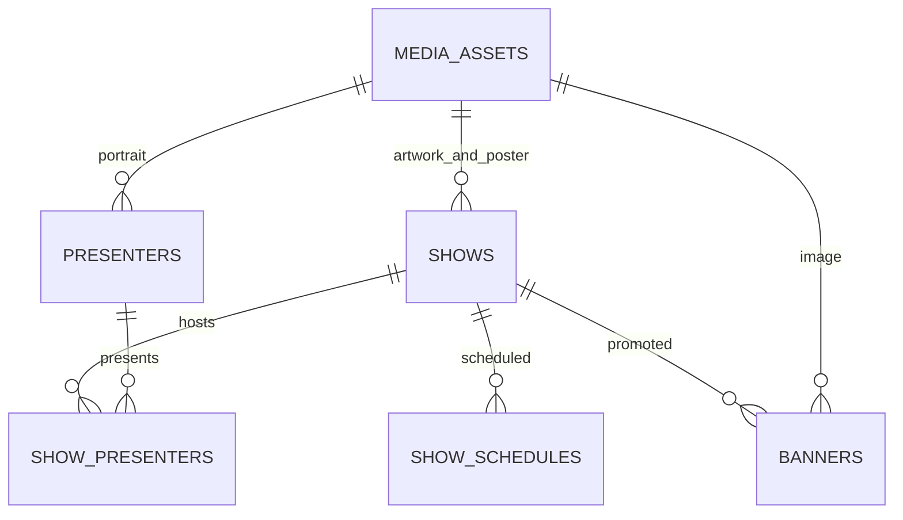

# Supabase content backend

## Deployment status

The linked project is **aceradio_db** (`dbgpfqyighcaquxwzkfe`). After the read-only audit and the user's explicit approval on 15 October 2026, both migrations were applied, the verified content was imported, and Supabase content was enabled. The initial audit found no public tables, migrations or Storage buckets; the deployment did not replace existing production content.

The current public catalogue contains **11 shows, 10 presenters, 27 weekly schedule slots, 11 banners and 31 referenced media assets**. At the user's explicit request, `20261015110000_remove_station_tables.sql` was deployed on 15 October 2026 and deleted `station_team`, `station_settings` and `station_milestones`. There are now **seven public content tables**, all with RLS, and 18 remaining content/Storage policies. The About story, founders, timeline, station identity and all contact/social links are frontend content. The original 32 Storage objects remain intact, including the unused legacy founder photo. No staff accounts have been granted access.

Before removal, all six rows from the three tables were backed up to ignored `.qa/supabase/station-tables-backup-20261015.json` with restricted file permissions. Dependency checks found no incoming foreign keys. The migration replaces dependent APIs before issuing exactly three `DROP TABLE` statements, without `CASCADE`; unrelated content and Storage objects are not deleted or overwritten.

Ignored `.env.local` and the linked EAS project's **development, preview and production** environments now contain the public URL/publishable key and `EXPO_PUBLIC_CONTENT_SOURCE=supabase`. The EAS profiles explicitly select their matching environment. No privileged key is included in the application. A new build is needed to install this integration; no build was submitted or published by this deployment.

Without an explicit source flag, code defaults to the bundled catalogue for unconfigured checkouts. Bundled mode remains available for rollback. The user requires approval before future production migrations/imports or another content-source switch; CLI linkage alone does not grant approval. The deployment above was explicitly approved.

## Audit and source of truth

| Content | Existing source | Deployed import |
| --- | --- | --- |
| Shows | `src/data/shows.ts`; verified `https://api.ace.radio/shows` response | 11 shows; current API title, tagline, host order, category and display order; existing app IDs |
| Presenters | API `hosts`; individual local show portraits and Christopher's founder photo | 10 named people; 9 known individual images; absent bio/photo stays null |
| Schedules | API structured days/start/end; matches bundled promotional schedules | 27 weekly start-day slots in `Africa/Johannesburg` |
| Spotlight banners | `https://api.ace.radio/banners`; bundled posts | 11 banners and their original API IDs/order |
| Media | Existing artwork/photos in `assets/` | 31 images referenced by current radio content; 32 initial objects preserved. All 22 show/banner API image bytes matched existing files by SHA-256 |
| Contact/social links | `src/config/station.ts` | Frontend only; no settings table or query dependency |
| About and station identity | `src/data/about.ts`, `src/config/station.ts`, bundled founder photos | Frontend only; founder/history tables removed |
| Announcements | None in the checkout/API responses | Empty table; no fabricated messages |
| Listener counts | Verified Icecast `/stream` statistics | Live, short-lived public Edge Function query; no database counter or imported sample figures. See `docs/listeners.md` |
| Favourites and notification preference | Device AsyncStorage | Remain local; no listener account is introduced |
| Audio | `src/config/station.ts`, `RadioPlayback`, native/web transports | Independent of Supabase; the backend cannot stop or redirect the audio connection |

The website's existing public API client was used only to capture/verify source responses. Its API credential is not embedded in the app or committed import. `supabase/import/catalogue.json` is the original verified source snapshot, including historical station records, source references and image hashes. The seed/import allowlist includes only the seven remaining tables, so historical station rows are ignored and cannot recreate or target removed tables. Future `prepare-import.cjs` runs no longer include station/About records or founder-only images. Existing show copy from the app is retained where the API has no description. API timestamps without a timezone remain source metadata; they are not assigned a guessed timezone.

The public API uses some different show IDs. The database preserves the app's IDs and records the API IDs separately:

| API ID | Preserved application/database ID |
| --- | --- |
| `ace-mornings` | `mornings` |
| `the-renssance` | `renaissance` |
| `the-restart` | `restart` |
| `kittys-boombox-hits` | `kitty` |
| `retro-reloaded` | `retro` |

Other IDs already match. Saved favourites and existing app detail routes keep working. Missing presenter bios are null. Jarred Sisam has no verified individual portrait; a group photo is not silently assigned to him. No exact day is invented for the “July 2025” milestone.

## Schema

Migrations live in `supabase/migrations/`. The original three migrations preserve deployment history. `20261015110000_remove_station_tables.sql` adds the radio-only v3 RPC, replaces v1/v2 with compatible wrappers and drops the three station tables. Replaying all migrations followed by the current seed produces the seven-table schema; do not edit already deployed migrations.



- `shows`: stable ID, external source identity, title, subtitle, description, image references, accent, category, order, publication status and source metadata.
- `presenters`: identity, name, optional bio/photo and external source identity.
- `show_presenters`: ordered many-to-many show/presenter membership.
- `show_schedules`: weekly day (`0 = Sunday`), minute-precision start/end, SAST timezone, optional effective start/end dates. End before start means an overnight slot. Effective dates apply to the slot's start day. Multiple slots per show are supported.
- `media_assets`: immutable bucket/path, MIME type, dimensions, SHA-256, alt text and optional original URL.
- `banners`: independent promotional image, optional show/HTTPS destination, placement (`home_spotlight` or `home_banner`), display order, publication window and status.
- `announcements`: title/body, optional HTTPS destination, priority, publication window and status.
- `app_private.content_staff`: trusted membership tied to `auth.users`; roles `admin`/`editor`. Not exposed through the Data API or writable by listeners.

Foreign keys protect referenced media and presenters from deletion; deleting a show cascades its join/schedule rows. Banner references prevent accidentally deleting a promoted show. Archive rather than delete published content. Unique source identities, join positions and schedule definitions prevent duplicate imports.

Current clients call `get_app_content_v3()`, which contains only dynamic radio content and referenced published media. `get_app_content()` and `get_app_content_v2()` delegate to v3 for dynamic content and add frozen public station/About payloads captured from the previous APIs. This keeps their old response shapes usable after the tables are gone. Those compatibility values are SQL literals, not replacement tables or editable backend settings. No staff-only/draft station data is exposed in them. Keep the original Storage objects while older clients still use their image references.

## Access control and future dashboard

Public tables have RLS enabled with explicit grants. `anon` and ordinary authenticated listeners can read only published content and visible relationships. Authenticated approved staff can read drafts and edit content. No sign-up metadata or user-supplied role can grant staff access.

`is_content_editor()` is a narrowly scoped `SECURITY DEFINER` membership lookup with an empty search path. The catalogue RPC is **SECURITY INVOKER**, so it preserves RLS and explicitly returns published-only content even for a signed-in editor. `starts_at`/`ends_at` windows are applied to banners/announcements; the client also filters expired cached entries.

No staff accounts are fabricated or granted by the seed. When the future dashboard exists, invite a real user using Supabase Auth, then a trusted administrator can add their actual UUID:

```sql
-- Run only for an actual authorised staff member; substitute their Auth UUID.
insert into app_private.content_staff(user_id, role)
values ('ACTUAL_AUTH_USER_UUID', 'editor');
```

The dashboard should use the user's normal authenticated client and these RLS policies. It must not expose a service-role/secret key. Membership administration remains a trusted server/SQL operation. `src/types/database.ts` contains the generated public schema types from the deployed database. Run `npm run backend:types` after approved schema changes to regenerate them. The mobile client also validates the complete versioned RPC response at runtime.

Storage buckets are `show-artwork`, `presenter-photos`, `banners` and `station-media`. They are **public promotional media** with a 10 MiB per-file limit and PNG/JPEG/WebP allowlist. Only approved staff can upload/update/delete through user credentials. Public bucket files are public regardless of a draft database row: do not put confidential drafts in these buckets. Use a separate private bucket for confidential content.

## Data access, caching and lifecycle

`ContentProvider` supplies Home, Shows, Show Details, Saved, schedules, spotlight banners and announcements. Supabase mode calls `get_app_content_v3()` once per catalogue refresh; there is no per-card request. PostgreSQL returns a consistent snapshot, and Zod validates database responses and restored caches before screens render them.

About renders its story, founders, bundled photos, timeline, vision, location and footer immediately from local files. About, Settings and social links read contact/social details directly from `src/config/station.ts` without a content query or cache dependency. The runtime content type has no station/About/contact fields. Home also uses local station identity/location.

TanStack Query deduplicates reads, caches data for 60 seconds and persists the public payload in AsyncStorage for up to seven days, isolated by project URL/source/schema version. Refetch runs every minute while foregrounded, on foreground return when stale, and on browser reconnection. Native periodic refresh/manual retry recovers after connectivity returns. Requests have a 15-second limit and two query retries. Failed refreshes retain valid cached data and show an explanation. First load has a loading state, failed first load has Retry, and published-empty catalogues show an empty state. Expired cached banners/announcements are removed on the local clock.

Version 1 and 2 persisted payloads remain compatible: validation ignores legacy station/About/contact fields and maps only the useful radio content. The cache namespace deliberately stays unchanged so upgrading does not discard an existing offline catalogue. New network requests use API version 3.

The audio provider mounts even while content is loading or unavailable. Listen Live falls back to the station identity when no schedule is available. A successful catalogue refresh can update player metadata but does not recreate the audio transport. User-selected show metadata remains available during playback if that show is later removed. The native background-media patch is unchanged.

The separate `listener-stats` Edge Function supplies a public aggregate count from Icecast. It does not query or write this database. Its client query is not persisted with the catalogue, expires stale counts, and never falls back to sample figures. See [listener implementation and verification](listeners.md).

## Repeating an approved deployment

The initial deployment is complete. For a future deployment, review pending migrations, the import manifest and `supabase/seed.sql` first and obtain approval for those production changes. These commands **write to the linked project**:

```sh
npm run backend:migrate
npm run backend:import -- --apply --confirm-project dbgpfqyighcaquxwzkfe
```

The importer first verifies each local file against its recorded hash (32 files in the original checked-in snapshot). It uploads content-addressed paths with `upsert: false`; an existing path is downloaded and hash-checked instead of overwritten. Only after successful uploads does it execute the seed transaction. Every seed insert uses `ON CONFLICT DO NOTHING`. Rerunning does not duplicate rows or overwrite staff edits. A failed data transaction can leave uploaded, unreferenced promotional objects; do not delete objects automatically to “roll back”.

The Node-only import script obtains its privileged key through the linked CLI and retains it only in process memory. It never writes a privileged key to an app environment or log. Nothing under `scripts/backend/` is imported by the mobile application.

Then verify the current public API, legacy API availability and the source image bytes referenced by the current catalogue, without changing data:

```sh
npm run backend:verify
```

The initial deployment already configured the following **public** values in ignored `.env.local` and the three EAS environments. For a separately approved project/setup, configure the equivalent values after verifying its backend:

```dotenv
EXPO_PUBLIC_CONTENT_SOURCE=supabase
EXPO_PUBLIC_SUPABASE_URL=https://dbgpfqyighcaquxwzkfe.supabase.co
EXPO_PUBLIC_SUPABASE_PUBLISHABLE_KEY=<public publishable key or legacy anon key>
```

`npm run backend:configure` can populate URL/key from the linked CLI and preserves the current content source. `npm run backend:configure-eas` is a dry run unless `--apply --confirm-project <ref>` is supplied; use repeated `--environment development --environment preview --environment production` flags to target all three environments. It verifies the linked EAS project and sets only the three public variables above. Never use `SUPABASE_SERVICE_ROLE_KEY`, an `sb_secret_*` key, a database password or a CLI access token in `EXPO_PUBLIC_*`. Expo embeds those variables in the application bundle. `.env.local` is ignored and not sent to EAS by the current ignore rules. Do not enable the Supabase flag without its URL/key.

Restart Metro after changing the environment. Install a new native preview build for the initial integration; later published content changes arrive through refresh without new app releases. An approved rollback uses `EXPO_PUBLIC_CONTENT_SOURCE=bundled` in a subsequent build; do not reset/drop the remote database. `supabase db reset --linked` is never part of this workflow.

## Remaining setup and device checks

- Build and install a fresh Android/iOS preview with `npm run build:android -- --clear-cache` or `npm run build:ios -- --clear-cache`. EAS already has the required public variables. iOS internal distribution still requires Apple signing/device provisioning.
- On physical devices, check initial content loading, image loading, saved favourites, foreground refresh and offline reopening after one successful load. Test audio and system controls while content is unavailable as well as while it refreshes.
- Invite actual authorised staff through Supabase Auth and grant their UUIDs membership before connecting a future dashboard. The mobile app requires no listener sign-in.
- Supply verified presenter bios, Jarred Sisam's individual portrait and any real announcements when available. They intentionally remain absent rather than invented.

## Reproduce and test

Verified on 15 October 2026 after table removal: all **75 tests** passed (21 content, 30 radio, 16 navigation, 8 web input), and Android/iOS/web bundles exported successfully with Supabase enabled. Live SQL confirmed the three tables are physically absent, all remaining content row counts match the pre-removal audit, all seven tables retain RLS, and 18 content/Storage policies remain. The production app fetch/mapper passed against v3, v1/v2 public station payloads matched the backup exactly, and all 31 currently used images matched their source hashes.

The migration tests rehearse upgrading the original populated station tables, verify their physical removal, compare v1/v2 content before and after, confirm that the current seed remains repeatable, and exercise public/staff RLS on the remaining schema. About also renders without a content provider, and old persisted catalogues remain compatible. Physical device checks and the optional Docker/pgTAP suite have not been run in this environment.

```sh
npm run backend:seed
npm run backend:import                 # local validation/dry run only
npm run test:content
npm run test:radio
npm run test:navigation
npm run test:web-input
npm run typecheck
npx expo export --platform all --output-dir .qa/content-export
```

Content tests execute the actual migrations/seed and RLS in embedded PostgreSQL (PGlite), mocking only Supabase-owned Auth/Storage primitives. They verify public/staff/ordinary-user permissions, draft isolation, idempotent imports, preservation of edits, integrity constraints, Storage policies, decoded content, schedules, missing data and privileged-key rejection. This does not replace the post-deployment verification of real Supabase Auth/Storage behavior.

With Docker and the Supabase local stack available, the same migrations/seed can also be exercised with `npx --yes supabase start`, `npx --yes supabase db reset --local` and `npx --yes supabase test db`. The SQL test in `supabase/tests/content.test.sql` uses pgTAP. These are local-only commands.

The checked-in manifest/seed make the initial import reproducible without needing the old API. To prepare a future reviewed import, capture the actual API responses locally and run:

```sh
node scripts/backend/prepare-import.cjs --shows path/to/shows-response.json --banners path/to/banners-response.json
npm run backend:seed
```

The preparation command refuses unknown show IDs and mismatched images so new content cannot be guessed or silently replace a different show. Keep raw responses/API credentials out of version control. Normal ongoing edits should happen in Supabase/admin, not by continually reseeding over staff changes.
